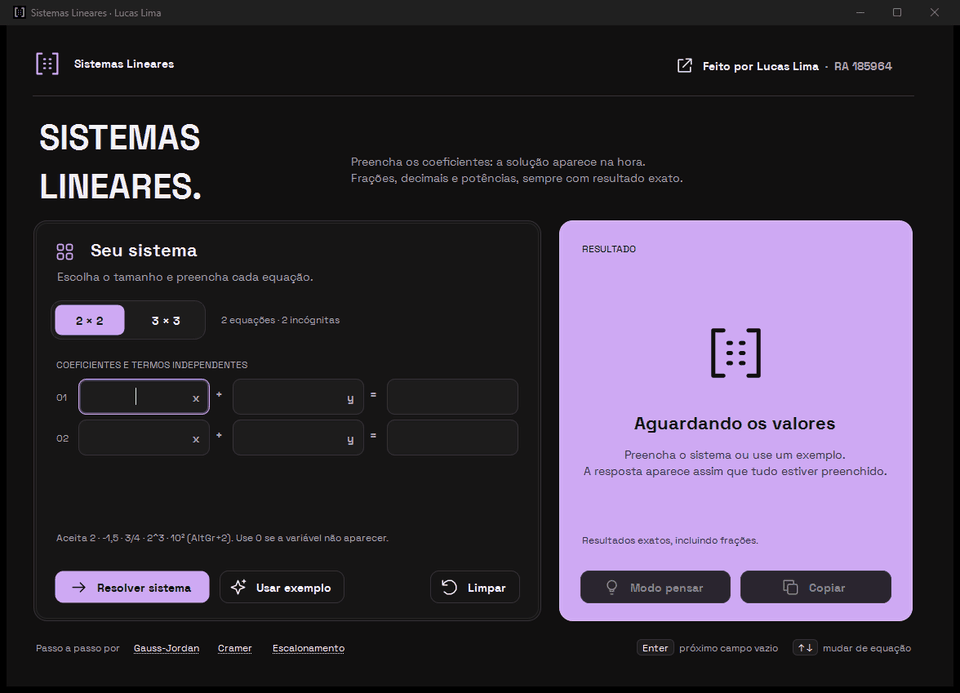

<h3>Resolve sistemas lineares 2×2 e 3×3 com cálculo exato, em apps nativos para Windows e Linux.</h3>

Site: <a href="https://lucas-lima.xyz">lucas-lima.xyz</a> 
Última versão: <a href="https://github.com/opZywl/sistemas-lineares/releases/latest">Releases</a> 
Autor: Lucas Lima · RA 185964 

## Demonstração

## Instalando o Sistemas Lineares
Clique [aqui](docs/INSTALANDO.md) para ver como baixar, instalar e conferir o Sistemas Lineares.

O `SistemasLineares.exe` não tem assinatura digital, então o Windows SmartScreen pode avisar na primeira execução. No Linux, o binário `sistemas-lineares` roda direto ou se instala no menu de aplicativos. O código-fonte está neste repositório e cada release traz o SHA-256 dos arquivos.

## Recursos
- **Cálculo exato:** frações de inteiros de precisão arbitrária e eliminação de Gauss-Jordan, sem arredondamento.
- **Resposta automática:** a solução aparece assim que o último campo é preenchido, sem Enter. Enquanto você digita, o card mostra quantos campos faltam e a prévia das equações.
- **Resposta completa:** solução única, infinitas soluções com a forma geral em parâmetros `t1`, `t2`, … ou sistema sem solução.
- **Modo pensar:** o passo a passo de como a resposta foi calculada, com o porquê de cada operação, todas as contas, as matrizes com o pivô em destaque e a conferência nas equações originais.
- **Três métodos:** Gauss-Jordan, regra de Cramer (com a regra de Sarrus no 3×3) e escalonamento de Gauss com substituição de baixo para cima. O app lembra o último método escolhido.
- **Entrada flexível:** inteiros, decimais com vírgula ou ponto, frações como `3/4`, notação científica como `1e-6` e potências como `2^3`, `10^-2` e `10²` (AltGr+2), com aviso no campo que precisa de correção.
- **Teclado e rodapé interativos:** Enter leva ao próximo campo vazio, as setas mudam de equação e os links do rodapé abrem o Modo pensar direto no método escolhido.
- **Apps nativos:** no Windows, um único `SistemasLineares.exe` em Rust, Win32 e Direct2D/DirectWrite; no Linux, o `sistemas-lineares` em Rust e egui, com o mesmo visual. Os dois têm a Space Grotesk embutida e não precisam de .NET, de navegador nem de internet.
- **Integrado ao sistema:** DPI por monitor, alto contraste, leitor de tela (Narrador e NVDA no Windows, Orca no Linux), barra de título escura e janela lembrada entre aberturas.
- **Instalação opcional:** roda direto do download ou instala por usuário, sem administrador, com atalho no menu Iniciar ou no menu de aplicativos do Linux.
- **Versão HTML:** o `SistemasLineares.html` faz o mesmo cálculo no navegador, offline, no Windows, macOS ou Linux.

## Como funciona
Cada campo aceita um número exato, inclusive com potência, e o app monta a matriz aumentada [A | b] assim que todos estão preenchidos e aplica a eliminação de Gauss-Jordan. Uma linha do tipo 0 = c, com c diferente de zero, mostra que o sistema não tem solução; variáveis sem pivô viram parâmetros livres. Os números são frações de inteiros de precisão arbitrária, então uma diferença pequena nunca é confundida com zero por arredondamento.

Depois de resolver, o botão **Modo pensar** mostra a mesma resposta calculada pelo método escolhido. Na regra de Cramer, quando D = 0, o app explica por que o método não decide o sistema e continua por escalonamento, em vez de concluir algo errado a partir dos determinantes.

O método, com exemplos prontos para apresentar, está em [APRESENTACAO.md](APRESENTACAO.md). A organização do código está em [ARQUITETURA.md](docs/ARQUITETURA.md).

## Problemas
Encontrou um erro ou tem uma ideia? Clique [aqui](https://github.com/opZywl/sistemas-lineares/issues) para abrir uma issue.

## Licença
Este projeto está sob a [GNU General Public License v3.0](LICENSE).

Para quem não conhece a licença, segue um resumo dos pontos principais. Isto não é aconselhamento jurídico e não tem valor legal.

Você pode:
- usar
- compartilhar
- modificar

este projeto, inteiro ou em parte, de graça e até comercialmente. Porém, se compartilhar uma versão modificada:

- **Você precisa divulgar o código-fonte.**
- **Ela também precisa ser licenciada sob a GPL.**

A fonte Space Grotesk tem licença própria, a SIL Open Font License 1.1, em [assets/SpaceGrotesk-LICENSE.txt](assets/SpaceGrotesk-LICENSE.txt).

## Configurando o ambiente
Clique [aqui](docs/AMBIENTE.md) para preparar o ambiente de desenvolvimento. O `abrir.cmd`, no Windows, e o `abrir.sh`, no Linux, conferem o Rust, compilam, rodam os testes e abrem o app em um passo.

## Contribuindo
Clique [aqui](docs/CONTRIBUINDO.md) para saber como contribuir. Veja também [BUILD.md](BUILD.md), [ARQUITETURA.md](docs/ARQUITETURA.md) e [CHANGELOG.md](CHANGELOG.md).

 
Feito por <a href="https://lucas-lima.xyz">Lucas Lima (Zywl)</a> · RA 185964 · <a href="https://github.com/opZywl">@opZywl</a>

